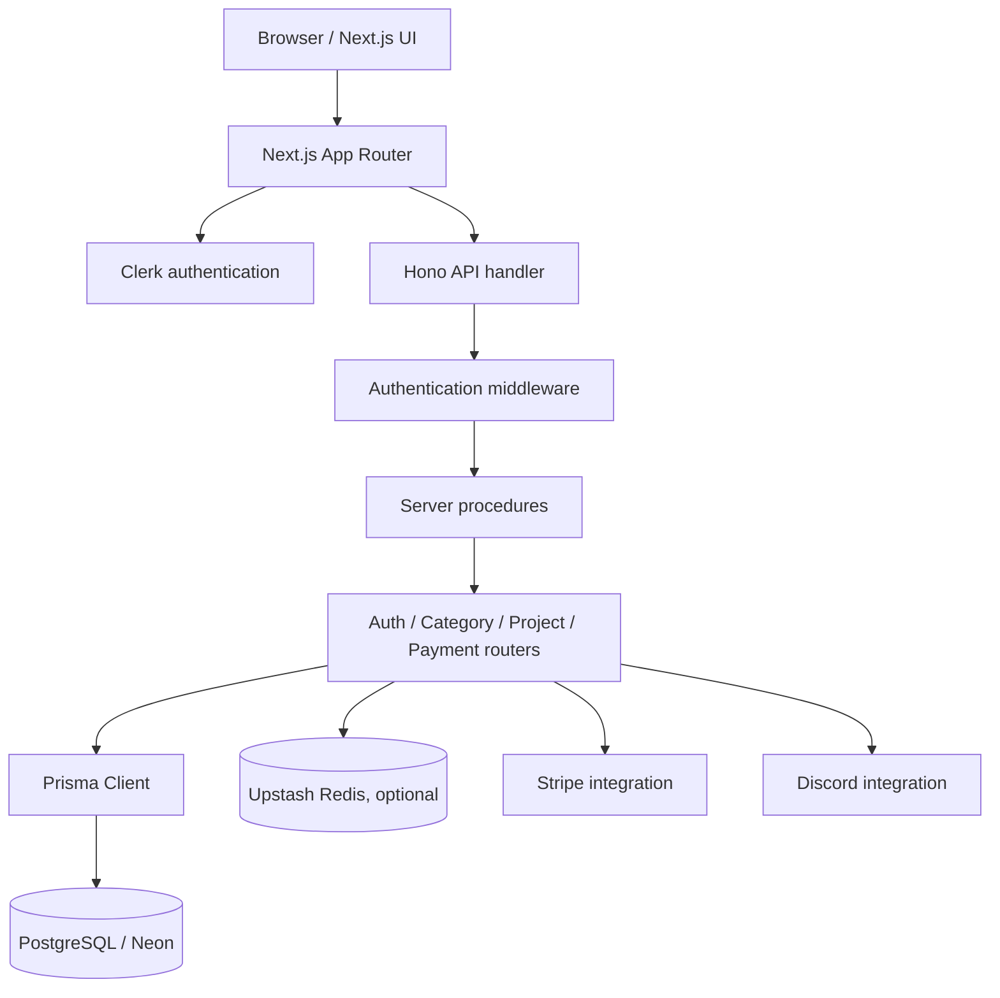

    

# PingPanda | SaaS Event Monitoring Platform

PingPanda is a web application for organizing application events and delivering structured event information to user workspaces. The repository contains a Next.js application, a Hono-based API layer, Clerk authentication, Prisma data models backed by PostgreSQL, and integrations for payments and Discord-oriented workflows.

The platform's core data model centers on users, event categories, events, delivery state, and monthly quotas. Authenticated users can manage categories and projects through server-side procedures. The API supports user authentication through Clerk sessions and bearer API keys.

> **Repository scope:** This repository is the web application and API implementation. It should not be confused with a production-grade uptime probe network. The checked-in code documents event ingestion and organization primitives; operational monitoring, alert delivery guarantees, and production readiness must be assessed against the deployed environment and the complete backend behavior.

## Contents

- [Product overview](#product-overview)
- [Core capabilities represented in the code](#core-capabilities-represented-in-the-code)
- [Technology stack](#technology-stack)
- [System architecture](#system-architecture)
- [Repository layout](#repository-layout)
- [Prerequisites](#prerequisites)
- [Local setup](#local-setup)
- [Environment configuration](#environment-configuration)
- [Database setup](#database-setup)
- [Development commands](#development-commands)
- [Authentication model](#authentication-model)
- [Data model](#data-model)
- [API organization](#api-organization)
- [Deployment considerations](#deployment-considerations)
- [Security and operational notes](#security-and-operational-notes)
- [Troubleshooting](#troubleshooting)
- [Contribution](#contribution)

## Product overview

Event-driven applications produce structured information whenever a user action, background job, integration, or system component performs work. That information is useful only when it can be organized, inspected, and routed to the right destination.

PingPanda provides the foundations for a SaaS event workflow:

1. A user authenticates through the application.
2. The application associates the external identity with a local user record.
3. The user works with project and event-category resources.
4. Event records store a name, structured JSON fields, a formatted message, ownership, timestamps, and a delivery state.
5. Monthly quota records provide a place to track usage.
6. Payment and Discord-related modules provide integration points for subscription and notification workflows.

The current database schema and API structure are the source of truth for what is implemented. The product should not be described as having guaranteed delivery, a distributed monitoring agent, or a particular SLA unless those capabilities are implemented and operated separately.

## Core capabilities represented in the code

| Area | Repository evidence |
|---|---|
| Web application | Next.js App Router under `src/app` |
| Authentication | Clerk integration and local user lookup |
| API routing | Hono application mounted under `/api` |
| Typed API surface | Exported `AppType` from the Hono router |
| User data | Prisma `User` model |
| Event organization | `EventCategory` and `Event` models |
| Delivery state | `PENDING`, `DELIVERED`, and `FAILED` enum values |
| Usage accounting | Monthly `Quota` model |
| Payments | Dedicated payment router and Stripe dependency |
| Discord integration | Discord REST dependency and optional Discord user identifier |
| Caching integration | Upstash Redis variables in `.env.example` |

The table describes code structure and data-model support. It does not imply that every integration is fully configured in every deployment.

## Technology stack

- **Next.js 14 and React 18:** web application framework and UI runtime.
- **TypeScript:** typed application and server code.
- **Hono:** API router and Vercel-compatible request handler.
- **Clerk:** authentication provider.
- **Prisma:** schema definition and database client generation.
- **PostgreSQL:** relational data store.
- **Neon serverless driver:** serverless PostgreSQL connectivity.
- **Upstash Redis:** optional caching integration represented by environment variables.
- **Stripe:** payment integration dependency and payment router.
- **Discord REST:** Discord integration dependency.
- **Tailwind CSS and Radix UI:** styling and accessible UI primitives.
- **Zod and React Hook Form:** validation and form tooling.

## System architecture



### Request lifecycle

1. The browser loads the Next.js application.
2. Clerk provides the authenticated identity when a user session exists.
3. Requests reach the Hono API application, which is mounted at the `/api` base path.
4. Private procedures attempt bearer API-key authentication when an Authorization header is present.
5. If API-key authentication does not resolve a user, the middleware checks the Clerk session and maps the external Clerk ID to the local Prisma user record.
6. The relevant router performs application operations through the database client or an integration.
7. The response returns through the Hono handler.

The current middleware uses a bearer token format and looks up a local user by the stored API key. Keep API keys private and treat them as credentials.

## Repository layout

```text
.
├── prisma/
│   └── schema.prisma          # PostgreSQL models and enums
├── public/                    # Public static assets
├── src/
│   ├── app/
│   │   ├── (auth)/            # Authentication route group
│   │   ├── (landing)/         # Public landing route group
│   │   ├── api/               # API route handlers
│   │   ├── dashboard/         # Dashboard routes
│   │   ├── globals.css
│   │   └── layout.tsx
│   ├── components/            # Reusable UI components
│   ├── hooks/                 # React hooks
│   ├── lib/                   # Shared libraries
│   ├── server/
│   │   ├── routers/           # Auth, category, payment, project routers
│   │   ├── __internals/       # Server procedure infrastructure
│   │   ├── env.ts
│   │   ├── index.ts           # Hono app composition
│   │   └── procedures.ts      # Authentication middleware and procedures
│   ├── config.ts
│   ├── db.ts                  # Prisma/database client
│   ├── middleware.ts          # Next.js middleware
│   └── utils.ts
├── .env.example
├── package.json
├── prisma/schema.prisma
└── README.md
```

## Prerequisites

Before running the application locally, prepare:

- Node.js compatible with the Next.js 14 toolchain.
- npm, with the committed `package-lock.json`.
- A PostgreSQL database. A Neon project is compatible with the configured serverless driver.
- A Clerk application for authentication.
- Stripe credentials if you intend to exercise payment flows.
- Upstash Redis credentials only if the Redis-backed caching path is enabled.
- Discord application credentials only if the relevant Discord functionality is enabled.

The application cannot be fully exercised with only a local Node.js installation because authentication and database-backed functionality depend on external services.

## Local setup

```bash
git clone https://github.com/Brajesh31/PingPanda_AI_SaaS_Monitoring_Platform.git
cd PingPanda_AI_SaaS_Monitoring_Platform
npm ci
```

Create a local environment file:

```bash
cp .env.example .env
```

Populate the variables required by the features you intend to run. Never commit the populated `.env` file.

Start the development server:

```bash
npm run dev
```

Open the local URL printed by Next.js in the terminal.

## Environment configuration

The checked-in `.env.example` currently contains the Upstash Redis placeholders:

```dotenv
REDIS_URL=
REDIS_TOKEN=
```

Other integrations require provider-specific configuration. Before deploying, inspect the current environment access in `src/server/env.ts`, `src/db.ts`, the Clerk setup, payment router, and webhook handlers. Configure only the variables actually read by the application and use the exact names expected by those modules.

| Integration | Configuration responsibility |
|---|---|
| PostgreSQL / Neon | Provide the database connection string expected by Prisma |
| Clerk | Configure publishable and secret authentication keys and allowed application URLs |
| Upstash Redis | Set `REDIS_URL` and `REDIS_TOKEN` when Redis caching is used |
| Stripe | Configure server-side secret and webhook credentials required by payment flows |
| Discord | Configure bot/application credentials required by Discord operations |

Do not paste real credentials into issues, pull requests, screenshots, or commits. Use deployment-platform environment settings for production secrets.

## Database setup

The Prisma schema declares PostgreSQL as the datasource. It defines:

- `User`: local account identity, external authentication ID, email, plan, API key, quota limit, optional Discord ID, and timestamps.
- `EventCategory`: a user-owned category with a name, color, optional emoji, and timestamps.
- `Event`: a user-owned event with a name, formatted message, JSON fields, delivery status, optional category relation, and timestamps.
- `Quota`: a user-associated monthly usage record with year, month, count, and update timestamp.
- `Plan`: FREE and PRO.
- `DeliveryStatus`: PENDING, DELIVERED, and FAILED.

After configuring the database URL, generate the Prisma client:

```bash
npx prisma generate
```

Apply the schema using the migration workflow adopted by the project. For a new development database, review the schema and use Prisma's development migration command to create a tracked migration. Do not use destructive schema synchronization against production data without a reviewed migration and backup.

Useful inspection commands:

```bash
npx prisma validate
npx prisma format
npx prisma studio
```

## Development commands

| Command | Purpose |
|---|---|
| `npm run dev` | Start Next.js development server |
| `npm run build` | Build the Next.js application |
| `npm run start` | Start the production Next.js server |
| `npm run lint` | Run the lint script configured in package.json |
| `npm run deploy` | Invoke the configured Wrangler deployment command |
| `npx prisma generate` | Generate Prisma client |
| `npx prisma validate` | Validate the Prisma schema |

The repository's lint script is `next lint`. If the installed Next.js version or CLI configuration changes, verify that this command remains supported rather than assuming it succeeds.

## Authentication model

The server procedure middleware supports two paths:

1. **Bearer API key:** reads the Authorization header, extracts the token after the scheme, and looks up a user by the `apiKey` field.
2. **Clerk session:** if API-key lookup does not authenticate the request, obtains the current Clerk user and looks up the local user by `externalId`.

A valid external Clerk identity without a corresponding local `User` record is not sufficient for private procedures. Account provisioning must create or synchronize that local record.

## Data model and event lifecycle

The `Event` model stores both a human-readable `formattedMessage` and structured `fields` JSON. The delivery status begins as `PENDING` and can represent `DELIVERED` or `FAILED`. The schema includes a timestamp index for event queries.

The schema does not, by itself, guarantee exactly-once processing, retry behavior, ordering, or durable delivery. Those guarantees require implementation in the delivery workers or integration handlers and should be verified independently.

## API organization

The Hono application is composed in `src/server/index.ts` and mounted under `/api`. The registered routers are:

- `/auth`
- `/category`
- `/payment`
- `/project`

The Next.js catch-all API route adapts requests to the Hono handler. When adding a router, register it in the central Hono composition file and document the public request contract, authentication requirement, validation rules, and error responses.

## Deployment considerations

The package includes both a Next.js production start command and a Wrangler deployment command. These represent different deployment paths. Choose one target deliberately and verify that its runtime supports the required Node.js APIs, database driver, environment variables, and webhook routing.

Before production deployment:

- Configure all required environment variables in the hosting provider.
- Apply database migrations through a controlled release process.
- Configure Clerk production URLs and authorized origins.
- Configure Stripe webhook endpoints and verify signatures.
- Restrict CORS to known application origins. The current Hono setup uses the CORS middleware without an explicit origin restriction, so production policy should be reviewed.
- Confirm Redis is optional or configured as expected.
- Verify logs do not expose API keys, tokens, or private event payloads.
- Test authentication, category management, project operations, payments, and webhook behavior in a staging environment.

## Security and operational notes

- API keys are credentials. Do not expose them in browser bundles or logs.
- Validate and authorize ownership for every user-scoped resource.
- Treat event JSON fields as untrusted input.
- Validate webhook signatures before processing provider callbacks.
- Add rate limits to public ingestion and authentication-sensitive endpoints.
- Use database backups and a migration rollback strategy.
- Review CORS policy before exposing the API publicly.
- Do not claim a production SLA without monitoring, incident response, and delivery guarantees.

## Troubleshooting

**Prisma client is unavailable.** Run `npx prisma generate` after installing dependencies and confirm that the database schema is valid.

**Database connection fails.** Verify the database URL, network access, Neon project status, and whether the runtime expects a pooled or direct connection string.

**Private API calls return 401.** Confirm that the bearer key belongs to an existing local user or that the Clerk session is valid and synchronized to a local `User` row.

**Redis-related errors appear.** Check the Redis environment variables and determine whether the code path requires Redis or should be optional in the current environment.

**Payment webhooks fail.** Confirm the endpoint URL, webhook secret, raw request body handling, and provider-side event configuration.

## Contribution

See [CONTRIBUTING.md](CONTRIBUTING.md), [docs/ARCHITECTURE.md](docs/ARCHITECTURE.md), and [docs/OPERATIONS.md](docs/OPERATIONS.md) before changing the API, database schema, authentication, or integration behavior.


## Documentation library

- [Architecture](docs/ARCHITECTURE.md): application layers, request flow, authentication, and data ownership.
- [Data model](docs/DATA_MODEL.md): Prisma entities, relations, constraints, and schema-change guidance.
- [API reference](docs/API_REFERENCE.md): Hono router structure, authentication, and endpoint documentation standards.
- [Integrations](docs/INTEGRATIONS.md): Clerk, Neon/PostgreSQL, Redis, Stripe, and Discord operations.
- [Operations](docs/OPERATIONS.md): environment setup, migrations, deployment, release verification, and recovery.
- [Contributing](CONTRIBUTING.md), [security policy](SECURITY.md), and [community guidelines](CODE_OF_CONDUCT.md).

Last updated: 2026-11-14 08:36 UTC
