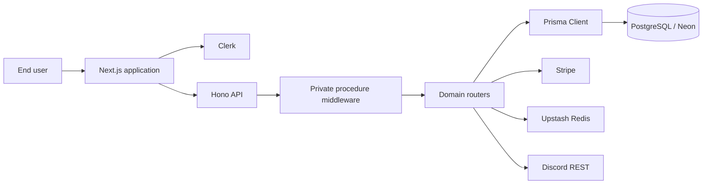
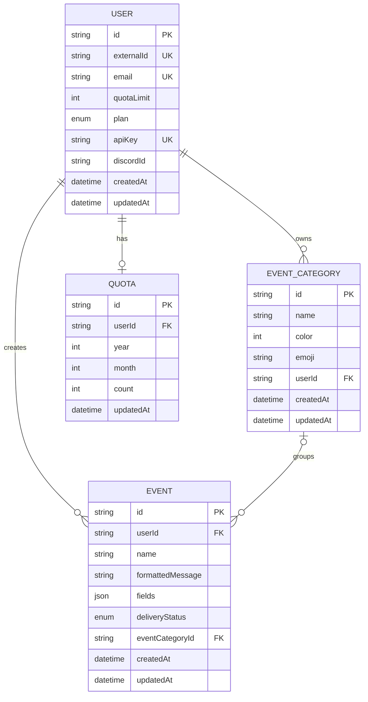
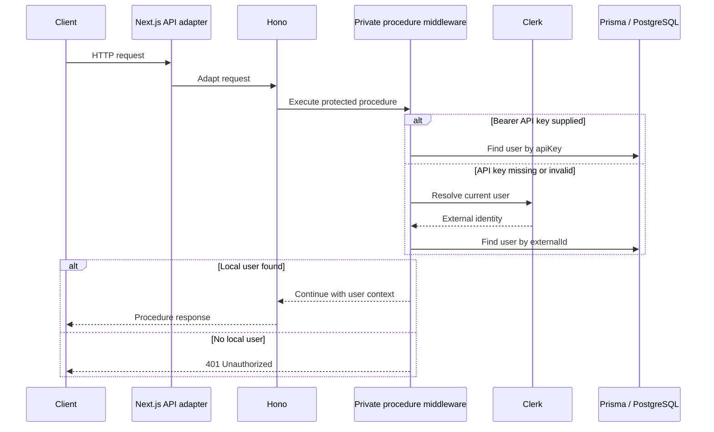

# PingPanda Architecture and System Design

## 1. Purpose

This document records the architecture visible in the repository. It is written for engineers who need to navigate the Next.js application, understand how requests enter the API, reason about identity and data ownership, and extend the database-backed event workflow.

This is an implementation guide, not a promise of production service levels. The actual deployment topology, external provider settings, and operational guarantees must be verified in the target environment.

## 2. Architectural style

The project is a modular full-stack web application:

- Next.js App Router provides the web application and API route integration.
- Hono composes server-side API routes.
- Server procedures provide reusable authentication middleware.
- Domain routers separate authentication, categories, payments, and projects.
- Prisma maps application models to PostgreSQL.
- External providers handle identity, payment, caching, and messaging integrations.

The design keeps UI route organization separate from API route composition and database schema definition.

## 3. High-level context

## 4. Application layers

### 4.1 Presentation layer

The `src/app` directory uses the Next.js App Router. Route groups separate authentication and landing experiences without requiring those group names to appear in the public URL. Dashboard routes are maintained separately. Shared UI is placed under `src/components`, while hooks and utilities live in their respective directories.

Keep presentation components focused on rendering, interaction, and calling application operations. Do not place privileged provider secrets in client-side components.

### 4.2 API adapter layer

The API route tree under `src/app/api` connects Next.js requests to the Hono handler. The catch-all route allows the Hono application to own the API route structure while Next.js provides the hosting adapter.

### 4.3 Hono composition layer

`src/server/index.ts` creates the Hono application, applies the CORS middleware, assigns the `/api` base path, and registers the domain routers:

| Prefix | Router |
|---|---|
| `/api/auth` | Authentication-related procedures |
| `/api/category` | Event category operations |
| `/api/payment` | Payment operations |
| `/api/project` | Project operations |

The same module exports the Hono handler and an inferred API type. This central composition point should be updated whenever a new router is introduced.

### 4.4 Procedure and authorization layer

`src/server/procedures.ts` defines a reusable middleware. It first checks for an Authorization header. If present, it extracts the token after the scheme and looks up a local user using the `apiKey` field. If this does not resolve a user, it attempts to obtain the current Clerk user and looks up the local record by `externalId`.

The middleware rejects requests that cannot be associated with a local user. This means authentication provider identity and application identity are related but distinct: a Clerk user must also have a corresponding local database record.

Resource authorization remains a domain responsibility. A successful authentication check does not automatically prove that the user owns a particular project, category, or event. Each operation must scope database access to the authenticated user.

### 4.5 Persistence layer

`prisma/schema.prisma` defines a PostgreSQL schema. Prisma Client is generated during installation through the package's postinstall script and can also be generated explicitly.

The database adapter is configured for a serverless PostgreSQL environment. Keep connection management compatible with the deployment runtime and avoid creating uncontrolled database clients per request.

## 5. Domain model

### User

The User model stores the local account identifier, optional external identity identifier, unique email, plan, optional quota limit, unique API key, optional Discord identifier, and timestamps. The `Plan` enum currently contains `FREE` and `PRO`.

### EventCategory

Categories are user-owned and have a name, integer color value, optional emoji, and timestamps. The schema enforces uniqueness of a category name within a user's scope. It does not make category names globally unique.

### Event

Events are associated with a user and may optionally be associated with an event category. Each event contains a name, formatted message, structured JSON fields, a delivery status, and timestamps. The delivery status enum includes PENDING, DELIVERED, and FAILED.

### Quota

The quota model stores a user ID, year, month, count, and update timestamp. The current schema has one quota row per user due to the unique constraint on `userId`. If the product intends to retain separate rows for multiple months, that constraint and the quota lookup/update strategy need to be reconciled. Do not assume a complete historical monthly quota ledger from the current schema alone.

## 6. Request and authentication flow

A future authentication change should explicitly define what happens when a bearer header is present but invalid. The current middleware falls through to Clerk session resolution rather than treating the invalid bearer value as an unconditional terminal failure.

## 7. Integration boundaries

### Clerk

Clerk is the external identity provider. The local User table remains the application's source for plan, API key, quota, and domain relationships. Account creation and synchronization must keep these records consistent.

### Stripe

The payment router and Stripe dependency provide the payment integration boundary. Production payment processing should verify webhook signatures, use idempotency keys where appropriate, and reconcile provider events with local subscription state. The schema currently exposes a FREE/PRO plan enum, but the complete subscription lifecycle must be verified in the router and deployment.

### Upstash Redis

The example environment file includes `REDIS_URL` and `REDIS_TOKEN`. Redis should be treated as an optional external cache only where code explicitly uses it. Cache failure must not silently corrupt authoritative database state.

### Discord

The project includes Discord REST dependencies and a `discordId` field on User. Any Discord notification workflow should define destination ownership, retry behavior, rate-limit handling, and failure visibility.

## 8. Data integrity and ownership rules

Every domain query that reads or mutates user-owned data should include the authenticated user's identity in its filter. Do not trust a client-supplied user ID as proof of ownership.

For event creation and delivery:

- Validate the event name and structured fields.
- Enforce the user's quota before accepting usage.
- Store the event and initial delivery state consistently.
- Avoid marking an event delivered before the downstream provider confirms acceptance.
- Record failure details without exposing secrets or sensitive payloads.
- Make retries idempotent to avoid duplicate side effects.

These are architectural requirements for safe extension. They should not be interpreted as proof that every item is currently implemented.

## 9. Error handling and observability

API errors should be structured and should distinguish authentication failure, authorization failure, invalid input, quota exhaustion, provider failure, and unexpected server failure. Logs should include a request or event correlation identifier where possible, but must not contain bearer keys, full payment credentials, or sensitive event payloads.

Useful operational signals include:

- API request count and latency by route.
- Authentication failures.
- Event ingestion volume.
- Pending, delivered, and failed event counts.
- Quota usage and rejected requests.
- Database connection and query errors.
- Provider API failures and rate limits.
- Payment webhook verification and processing outcomes.

## 10. CORS and deployment boundary

The Hono application currently installs CORS middleware without a visible explicit allowlist in the composition file. A production deployment should restrict origins to the actual web application domains and handle credentials deliberately. Avoid wildcard origins with credentialed requests.

The package includes both Next.js `start` and Wrangler deployment commands. They are different deployment targets and should not be mixed without validating the adapter, environment variables, database connectivity, and webhook routing.

## 11. Architecture change checklist

When adding a domain feature:

1. Define the domain entity and ownership rules.
2. Add or update the Prisma schema.
3. Create a migration and validate it.
4. Implement server-side validation and authorization.
5. Add the operation to the appropriate router.
6. Register a new router centrally if needed.
7. Add UI routes or components.
8. Add tests for success, failure, and cross-user access.
9. Document environment variables and external provider setup.
10. Update the README and operations guide.

## 12. Known design questions to resolve before production

- Should monthly quota rows be unique by user and month rather than user alone?
- What is the intended API-key rotation and revocation process?
- Is event delivery performed synchronously or asynchronously?
- What retry and idempotency guarantees exist?
- Which exact deployment target is supported, Next.js hosting or Cloudflare Workers?
- What are the allowed production CORS origins?
- How are Clerk users provisioned into the local User table?
- How are Stripe subscriptions reconciled with the local Plan field?

These questions are worth resolving explicitly rather than hiding them behind broad product claims.
