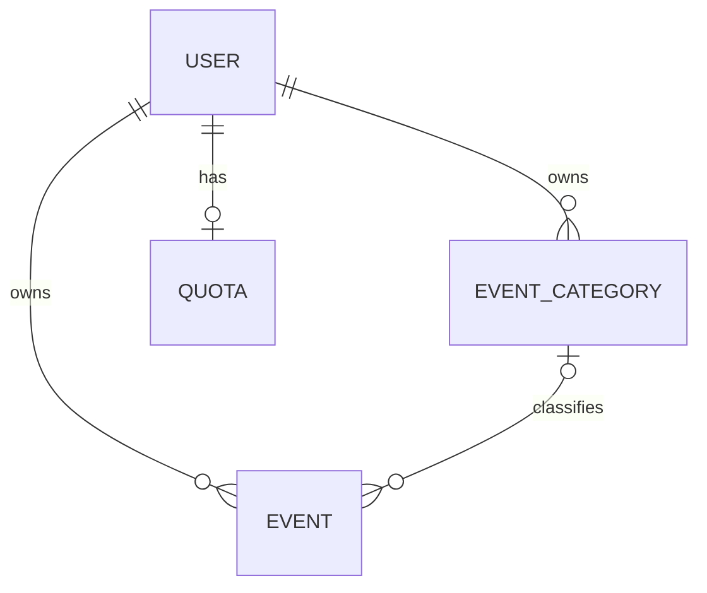

# PingPanda Data Model Reference

## Purpose

This guide summarizes the Prisma models and enums declared by the repository schema. The schema remains authoritative for exact field types, relations, and constraints.

## Entity relationships

## User

The User model represents a local application account. It includes a local ID, optional external identity ID, unique email, plan, optional quota limit, unique API key, optional Discord ID, and timestamps. External identity is mapped to the local account, while application-specific authorization and billing state live in the local database.

## EventCategory

EventCategory is a user-owned classification with a name, integer color value, optional emoji, owner relation, and timestamps. Category names are unique within a user's scope. Every operation that associates an event with a category must verify that the category belongs to the authenticated user.

## Event

Event stores an event name, formatted message, structured JSON fields, delivery status, owner, optional category relation, and timestamps. The status enum contains PENDING, DELIVERED, and FAILED. The schema records state, it does not itself implement a queue, retry policy, exactly-once processing, or provider acknowledgement.

## Quota

Quota stores user ID, year, month, count, and update timestamp. The current schema declares a unique constraint on userId. Consequently, it permits one quota row per user, not one row per user and month. If historical monthly quota records are intended, the constraint and migration strategy must be redesigned.

## Enums

- Plan: FREE and PRO.
- DeliveryStatus: PENDING, DELIVERED, and FAILED.

## Referential integrity

Review relation deletion behavior before changing the schema. Cascading deletion can remove dependent categories, events, or quota records. Restrictive relations can block account deletion until dependent records are handled. Define retention and deletion behavior explicitly.

## Indexes and query design

Indexes should follow observed query patterns. Event queries may filter by user and order by timestamp. Validate query plans against realistic data before adding indexes. Every index has storage and write costs.

## Schema change checklist

- [ ] Define the business rule and ownership scope.
- [ ] Update the Prisma schema.
- [ ] Validate and format the schema.
- [ ] Generate a migration.
- [ ] Test against a disposable database.
- [ ] Review unique constraints and relation actions.
- [ ] Add application validation and tests.
- [ ] Update architecture and operations documentation.
